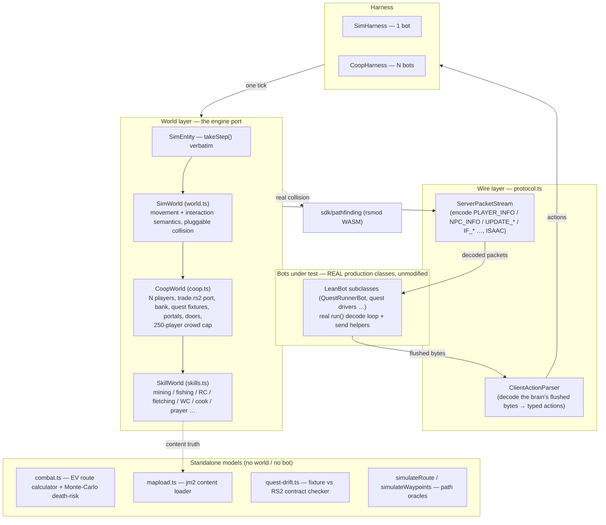

# The Offline Brain Simulator — Architecture, Capabilities & Limits

**What it is:** an offline port of the RuneScape server that runs the **real, unmodified bot brains**
(`LeanBot` subclasses such as `QuestRunnerBot` and the quest drivers: their actual `run()` decode loop, no
stubs, no test-only edits) against a
faithful re-implementation of the engine's movement, interaction, trade, bank, skilling and combat
rules — so a brain or protocol regression is caught by a `bun test` in **seconds** instead of in a
live run at minutes-to-hours per iteration.

**The thesis this whole thing exists to serve:** *live runs confirm, they do not discover.* Anything
you can reduce to "given this world state, the brain should decide X" belongs here. What's left for
live is a deliberately small, documented residue (see [Fidelity boundary](#fidelity-boundary--what-it-cannot-prove)).

> This document is the **capabilities & limits** reference. For the hands-on API ("how do I write a
> test") see [`README.md`](./README.md).

---

## Contents
1. [How to run it](#how-to-run-it)
2. [Architecture at a glance](#architecture-at-a-glance)
3. [The modules](#the-modules)
4. [What it CAN prove (capabilities)](#what-it-can-prove-capabilities)
5. [Fidelity boundary — what it CANNOT prove](#fidelity-boundary--what-it-cannot-prove)
6. [Engine facts the suite pins down](#engine-facts-the-suite-pins-down)
7. [The workflow](#the-workflow-brain--sim-test--one-live-smoke)
8. [Extending the sim](#extending-the-sim)
9. [Test-suite index](#test-suite-index)

---

## How to run it

```bash
cd server/webclient
bun headless/sim/run-tests.ts              # the gate: every suite, batched, with a per-file table
bun headless/sim/run-tests.ts --filter=quest   # only files whose path matches
# ...or bun test directly, ALWAYS from inside the sim directory (see the warning):
cd headless/sim
bun test world.test.ts                     # one file
bun test -t "wander"                       # by test-name pattern
```

⚠️ **Run `bun test` from `cwd = sim/`, never from `server/webclient` or the repo root.** Invoked from a
large tree, `bun test` can panic or segfault before a single test body runs; the trigger is the working
directory, not a failing test. `run-tests.ts` spawns every batch with `cwd = sim/` and reports a crashed
batch as PANIC instead of a silent green (its header has the details). Imports still resolve everywhere.
The WASM-collision suites (`world`, `levels`, the `*-geo` files) pay a ~5s `initPathfinding()` once.

Some modules are also **runnable CLIs** (via `bun run`, from anywhere):
- `bun combat.ts` — prints the level-1→99 melee route comparison from the engine's own formulas.
- `bun quest-drift.ts` — diffs every quest fixture against its RS2 scripts (fixture-drift detector).

---

## Architecture at a glance

Three concerns, cleanly separated: **the world** (engine semantics), **the wire** (protocol
encode/decode), and **the harness** (pumps ticks, exposes decisions). The bots-under-test are the real
production classes — the sim never subclasses or edits them.



**Data flow, one tick:** the harness advances the world → the world serializes state to `PLAYER_INFO` /
`NPC_INFO` / inventory / stat / interface packets (in the engine's exact order, ISAAC-encrypted) → the
**real** bot decode loop consumes them and flushes action bytes → `ClientActionParser` turns those back
into typed actions (`{type:'opnpc', op:3, index:11}`) → the harness returns `{actions, events, player}`
for the test to assert on. Nothing is faked at the brain boundary: the bot believes it is talking to a
server.

**Collision is pluggable.** `openField()` = everything walkable (fast, no WASM) for logic tests;
`rsmodCanTravel()` = the real rsmod WASM collision (`sdk/pathfinding`) for real-geometry routes.

---

## The modules

| File | Role |
|---|---|
| **`world.ts`** | The base server. `SimEntity.takeStep()` is a verbatim port of `PathingEntity.takeStep` (diagonal → E/W → N/S → `[0,0]`); `SimWorld` carries `validateAndAdvanceStep`, walk-1/run-2, the reversed 25-waypoint queue, `MoveClickHandler.clearPendingAction()` (MOVE cancels a pending op), "loc ops only on a zero-step tick", "I can't reach that!", npc `wanderMode`/`patrolMode`, and the World.cycle order (client input → NPCs → player). Exports the path oracles `simulateRoute` / `simulateWaypoints`. |
| **`coop.ts`** | `CoopWorld extends SimWorld` — **N real bots in one world**. Peers render into each bot's `PLAYER_INFO` with appearance **names** (so `findPlayerIndexByName` resolves), gathered **nearest-250, level-scoped** (the engine's BuildArea cap → the crowd-collapse model; `addCrowd()` adds cheap filler peers). TRADE is ported line-by-line from `trade.rs2` (request → reciprocal OPPLAYER4 → offer → 2-stage accept → capacity rule → decline-on-close). BANK models the noted-bulk contract (modal 5292, `P_COUNTDIALOG` dance, cert = unnoted+1). Also: quest+dialog **fixtures**, `SimPortal` two-stage ladders/trapdoors, `SimDoorLoc` (incl. diagonal-door leaf tiles) with real zone-packet emission, `removePlayer` (disconnect injection), a unique-index guard, and `CoopHarness`. |
| **`skills.ts`** | `SkillWorld extends CoopWorld` — mining (a cited `mining.rs2` port: roll/deplete/respawn/timer-neutral re-poke), fishing (a *behavioral* port of live-proven lessons), runecrafting, fletching, and generic archetypes (woodcutting, cooking, herblore, prayer-bury, thieving), plus worn-equipment (OPHELD2 wield, quest/level gates, armour-reduces-aggro). |
| **`protocol.ts`** | The wire layer. `ServerPacketStream` bit-exactly encodes `PLAYER_INFO / NPC_INFO / UPDATE_INV / UPDATE_STAT / IF_* / MESSAGE_GAME / REBUILD_NORMAL / UPDATE_ZONE_*` for the real client decoders; `ClientActionParser` reads bytes produced by the real `LeanBot` send helpers. Both mirror the live ISAAC streams. Its own suite validates it against the actual decoders. |
| **`harness.ts`** | `SimHarness` — one real bot ↔ one `SimWorld`, bypassing login the sound way (set `stream`/`inIsaac`/`outIsaac` directly). Pumps one tick at a time, returns `{actions, events, player}`. Queue helpers inject inputs the world can't produce (`queueMessage`, `queueInv`, `queueStat`, `queueOpenMain`). `linePath()` builds per-tile routes. |
| **`combat.ts`** | A **standalone** calculator (no world, no bot): every combat formula ported from the engine scripts. Two models — an **expected-value** pass for the level-1→99 route comparison (route *ordering*), and a **seeded Monte-Carlo** pass (`fightSessionMC` / `deathRisk`) that runs actual RNG fights for a **death probability** under a food budget (route *safety*). Also a CLI. |
| **`quest-drift.ts`** | Extracts each quest's observable **item contract** (which npc `inv_add`s / `inv_del`s which obj) from the real RS2 npc scripts and diffs it against the runner's hand-transcribed fixture — so a wrong item/npc in a fixture fails offline instead of only in a live smoke. Also a CLI. |
| **`mapload.ts`** | Parses the server's own `m{mx}_{mz}.jm2` maps so a test can say "mine the rock at (3285,3368)" and **fail if the server map has no rock there** — hand-registered-coordinate drift becomes a caught error instead of a live surprise. |

**Class hierarchy:** `SimEntity` → {`SimNpc`, `CoopPlayer`}; `SimWorld` → `CoopWorld` → `SkillWorld`.
Harnesses: `SimHarness` (1 bot) and `CoopHarness` (N bots). `combat.ts` / `mapload.ts` stand alone.

---

## What it CAN prove (capabilities)

Everything below is covered by a green test unless it says *modelled* (implemented in the world, ready
for a test to use). Grouped by domain; see the [test index](#test-suite-index) for the exact assertions.

**Movement & pathing (engine-exact)**
- `takeStep` order, the diagonal→cardinal fallback wiggle, walk-1 vs run-2 (with mid-run re-validation).
- The **permanent-wedge rule**: a blocked step returns `[0,0]` and does *not* advance the waypoint index.
- The **25-waypoint cap** and the "keep only the last 25" queue reversal.
- **Real-collision routes** (rsmod WASM) end-to-end: navgrid plans are step-legal and arrive; a
  corner-cutting (toVias-thinned) route wedges at a wall; a >25-tile single packet beelines and misses.
- **Multi-level travel**: the `mlDrive` follower walks a leg → OPLOC → telejump → detects the real plane
  change → advances → arrives; the climb bail-out **parks** (never wanders) on an unclimbable ladder.
- The **multi-level planner** picks the right ladder for upstairs, basements, and the underground mine.

**Interaction protocol (the whole defect class)**
- **MOVE cancels a pending OPLOC/OPNPC** (`clearPendingAction`) — the door/gate bug — and
  `suppressMoveUntil` fixes it.
- Loc ops fire only on a zero-step tick; npc ops fire adjacent (and the engine walks you *adjacent*, never
  *onto*, the target).
- **Trade**: full handshake, the overflow-cancel capacity rule, a busy partner, decline-on-move, and both
  players **recovering** afterwards.
- **Bank** (modelled in `coop.ts`): the noted-bulk round-trip (note-mode reset, `P_COUNTDIALOG`, cert=unnoted+1).
- **Doors**: a bot crosses a closed door via the *entire live path* offline — world blocks the tile → bot
  OPLOCs → world emits the real `LOC_DEL` zone packet → the bot's `DoorTracker` decodes it → bot crosses;
  and it **never** OPLOCs a door the tracker knows is open.
- **Wandering-NPC approach** (`stepToNpc`): catch a *pacing* Duke/Aubury and complete a talk/use step —
  and this is **stricter than live** (the sim models no engine-follow, so the bot must catch the moving
  npc unaided).

**Brain decisions (the production regressions)**
- The **npc stale-tile** rule (track `routeX[0]`, never `x>>7`); the climb reposition onto a reach-valid
  *side* tile of a multi-tile loc (never its occupied origin); the interaction-acknowledgement verdicts
  (ack / refused / no_ack / unknown); the level-up splash that blocks movement until dismissed.

**Skilling & content**
- The skilling actions (chop, burn, fletch, craft leather/jewellery, enchant, string) send the right
  ops in the right argument order, against ids re-derived from the packed tables; take-then-bury.
- Mining cadence (timer-neutral re-poke, depleted rocks), fishing, runecrafting, death/keep-3 and aggro
  are modelled in `skills.ts` / `coop.ts` for tests that need them.
- **jm2 content truth**: quest placements and stand tiles are checked against the server's own maps; a
  wrong coordinate is a caught cant-reach/no-op (drift detection).

**Players**
- **The 250-player collapse**: a player beyond the nearest 250 in a crowd is *invisible* to a bot
  (`findPlayerIndexByName` never resolves it): the engine's BuildArea cap; `addCrowd()` fills a cheap crowd.
  The gather is level-scoped: a 300-crowd on a different plane does not hide anyone.

**Combat routing & risk**
- *Ordering* (EV): the xp curve; formula max-hits vs live (cow 1, goblin 1, giant 6); giants beat all-cows;
  style rotation is worst; cows 1→60 in the live ballpark.
- *Safety* (seeded Monte-Carlo): a **death probability** per route under a food budget — cows are trivially
  safe, giants are lethal unfed and safe fed; deterministic per seed.

**Quests**
- The QuestRunnerBot drives a fixture end-to-end (travel/talk/use/dialog/choice/item-verify/retry).
- The quest drivers (Druidic Ritual, Death Plateau, Troll Stronghold, Lost City, Rune Mysteries recovery)
  run their decision tables, dialog policy and relaunch-resume paths offline.
- **Fixture drift is auto-caught**: each fixture step's claimed item is verified against the npc's real RS2
  `inv_add`/`inv_del` — a wrong item or npc fails offline (the checker is proven to have teeth).

**Wire protocol**
- Every packet the sim emits is decoded by the **real** client decode paths, and every action it parses
  was produced by the **real** bot send helpers — the protocol can't silently drift.

---

## Fidelity boundary — what it CANNOT prove

This is the deliberately-small **live-only residue**. Each item is a conscious modeling choice, with the
reason. If a task depends on one of these, it needs a live probe — the sim will not save you.

| Not modeled | Why / what it means | Where it's stated |
|---|---|---|
| **Portal / route DATA accuracy** (`portals.json` dests) | The *follower mechanism* is proven; whether a specific ladder's recorded dest matches the live map is not. Off by 1-3 tiles is tolerated by the follower but only *content* proves the dest. | `mltravel.test.ts` ("CANNOT prove") |
| **Quest COMPLETION** (varp branching, order, dialog gating) | The item-contract *drift* is now auto-caught (see `quest-drift.ts`), but the sim still doesn't execute the RS2 varp state-machine — step order, dialog-choice gating, and quest-var guards are proven only by the **one live smoke**. Boss/instanced legs are stubbed. | `coop.ts` quest block, `quest.test.ts` |
| **Boss fights / instanced / combat-maze / boat legs** | Dragon Slayer's Melzar's maze, map parts, ship, and the Elvarg boss are **stubbed/injected** in the DS spine test, not modeled. Combat resolution is the model below + live. | `quest.test.ts` (DS describe block) |
| **The live engine's exact combat RNG** | Death *risk* is now modeled (seeded Monte-Carlo, `deathRisk`), but from calibrated **formulas**, not the live ISAAC damage stream — special attacks, retaliate timing quirks, and true tail luck are live-only. It sizes food budgets; it doesn't replace a live shakeout. | `combat.ts` header, `combat.test.ts` |
| **Full BuildArea `viewDistance` dynamics** | The 250-cap + level-scoping (the load-bearing crowd-collapse behavior) *is* modeled now; the tick-by-tick viewDistance shrink/grow schedule and true 250-scale packet timing are approximated, not ported. | `crowd.test.ts`, `coop.ts` `PREFERRED_PLAYERS` |
| **In-world combat, skilling execution, loc respawn inside CoopWorld** | The coop world itself has no combat/skilling/respawn (those live in `skills.ts`/`combat.ts` as separate models). E.g. the coop world **has no anvil**, so bars withdrawn from the bank simply stay in the pack. | `coop.ts` FIDELITY LIMITS |
| **The engine's npc-follow** | The coop sim does not auto-chase a moving npc for the bot — which makes `stepToNpc` tests *stricter* than live (a feature, not a gap). | `wander-npc.test.ts` |
| **Event-loop starvation / real wall-clock timing** | Tick-accurate, not millisecond-accurate; a live event loop under load can starve in ways the deterministic pump won't show. | `combat.ts` / general |
| **Real thieving / mining RNG outcomes** | A successful `OPNPC3` surfaces as an `op-fired` event; feed the *result* (coins/xp) with `queueInv`/`queueStat`. Success **rates** are modeled; individual-roll luck is not the point. | `README.md` Limits |
| **`busy` nuance** | Modeled as "any main modal open"; the engine's `.busy` also covers queued scripts/delays — a minor over-simplification. | `coop.ts` FIDELITY LIMITS |
| **Peer rendering in the OLD single-bot `SimHarness`** | `SimHarness` structurally can't render a peer (`playerCount` stays 0). **`CoopHarness` DOES** render peers — use it for anything peer-to-peer. Not a limit of the sim, a limit of the *old harness*. | `harness.ts`, `crowd.test.ts` |
| **Real-collision diff coverage** | The rsmod collision was diffed against the engine only inside the Lumbridge↔Ardougne corridor (x2600-3260 / z3200-3520, L0). Elsewhere it trusts the WASM. | `README.md`, `blocked-tiles.ts` |

**The one-line seam:** the sim proves *mechanism* (does the brain do the right thing given a world
state); the live server owns *content truth* (do this map's rocks/ladders/quest-scripts actually match
what the sim assumed). The permanent live-only residue is **content-truth verification** (portal dests,
quest varp branching, real RNG tails, event-loop timing) — everything else, including the crowd collapse
and death-risk sizing that used to live here, has moved into the model.

---

## Engine facts the suite pins down

These were expensive to discover live and are now permanently asserted (several are counter-intuitive):

1. **`path[0]` of every MOVE packet is the player's own tile** → the first tick after any move click is
   burned consuming that self-start waypoint (zero steps). Hence the brains' "+1 cursor"; a resend replays
   a leg.
2. **A blocked step returns `[0,0]` and does NOT advance the waypoint index** → permanent wedge. Only a
   client re-plan recovers it.
3. **25-waypoint cap**: `queueWaypoints` keeps only the *last 25* of a longer list — a 50-tile single
   packet beelines at a far tile and wedges. Chunk it (brains send ≤24).
4. **MOVE cancels a pending OPLOC/OPNPC** (`clearPendingAction`) — the door/gate bug; hence
   `suppressMoveUntil = tick+6`.
5. **Loc ops fire only on a zero-step tick; npc ops fire pre- and post-movement** — which is why the
   brains send an npc op with *no* MOVE inside follow range and let the engine chase.
6. **The engine walks you to a tile ADJACENT to the target** (`naiveDestination`), never onto it.
7. **NPC stale-tile rule**: `moveCode()` updates only `routeX[0]/routeZ[0]`; fine `x>>7` freezes where the
   entity entered view. **Never read `x>>7` for position** — always `routeX[0]/routeZ[0]` + mapBuildBase.
8. **ISAAC packet order**: packets must be encoded in the same order their bytes are pushed (the cipher
   advances per packet). Engine order, mirrored: script packets (MESSAGE_GAME/IF_*) → PLAYER_INFO →
   NPC_INFO → inv/stat. A game message lands *before* the brain's tick; an inv update lands *after*.

---

## The workflow (brain → sim test → one live smoke)

```
   write / change a brain
          │
          ▼
   sim test  (jm2 world + real collision + watchdogs)   ← seconds, catches mechanism bugs
          │      most iterations stop here
          ▼
   ONE live smoke  (local server, LC_HOST)              ← confirms content truth only
```

The sim is where you **discover** and **iterate**; the live smoke **confirms** the content the sim can't
own (portal dests, quest varp branching, real-RNG tails). An automated drift detector guards the seam:
`quest-drift.ts` (fixture item-contract vs the RS2 scripts), which fails loudly rather than let a fixture
silently diverge.

---

## Extending the sim

- **A new brain decision test** → `SimHarness` + `SimWorld` (openField), assert on `actions`. See
  `README.md` "Writing a brain test".
- **A new multi-bot / trade / bank / crowd test** → `CoopHarness` + `CoopWorld`; `h.add({...})`
  each bot with a unique **index** (`addPlayer` now *throws* on a collision instead of silently zeroing a
  bot); `world.addCrowd(n, x, z, level)` for filler peers; `await h.start()`, drive, assert on events +
  `h.invCount`.
- **A new skill** → extend `SkillWorld`, port the cadence from the skill's `.rs2` script (cite it inline),
  add an archetype row.
- **A new content location** → let `mapload.ts` load the real jm2 rather than hand-registering coords, so
  drift is caught.
- **A real-geometry route** → use `rsmodCanTravel()` collision + the real portal graph (like
  `castle-door-wedge.test.ts` or `quest-troll-geo.test.ts`), not openField.
- **Golden rules:** never edit the bot to make a test pass (the brain under test must be the production
  one); cite the engine script for every ported rule; when you add a fixture (quests especially),
  remember it can drift — pair it with a live smoke and say so in the header.

---

## Test-suite index

Every `*.test.ts` in `sim/`, run together by `run-tests.ts`. `[WASM]` = pays the one-time rsmod init.

| File | Locks down |
|---|---|
| `protocol.test.ts` | The wire layer vs the real decoders/encoders (bit round-trip, PLAYER_INFO paths, fixed packets, action parsing). |
| `capabilities.test.ts` | Decode + primitive tests: VARP and run-energy framing, npc hitsplats, dialog-by-text, prayer, combat style, shop, unequip. |
| `chat-wire.test.ts` | The wired CHAT decode keeps PLAYER_INFO aligned (no desync). |
| `crowd.test.ts` | The 250-player collapse: a player beyond the nearest 250 is invisible (`findPlayerIndexByName` never resolves it); a crowd on another floor is level-scoped away; the exact 249-vs-300 boundary. |
| `world.test.ts` `[WASM]` | Engine movement semantics (takeStep, wedge, run/walk, MOVE-cancels-OP, zero-step loc ops, wander/patrol) + real-collision Ardougne routes + the path oracles. |
| `combat.test.ts` | Combat-math anchors (xp curve, max-hits vs live, route ordering) + **Monte-Carlo death-risk** (cows safe, giants lethal unfed / safe fed, deterministic) + the ranged model. |
| `ranged-kit.test.ts` | Ranged style buttons from the generated interface table; the ammo power rule (`player_ranged.rs2`). |
| `bury-combat.test.ts` | The bury table enumerated from source; take-then-bury. |
| `skilling-actions.test.ts` | The LeanBot skilling actions (chop, burn, fletch, craft leather/jewellery, enchant, string) and OPHELDU argument order. |
| `skilling-tables.test.ts` | The skilling component/item ids, re-derived from the packed tables (not the stale `.sym` files). |
| `levelup-modal.test.ts` | The level-up splash (`levelup.rs2`) and the engine queue behind it. |
| `interaction-ack.test.ts` | The interaction-acknowledgement verdicts (ack / refused / no_ack / unknown) and their window. |
| `loc-scene.test.ts` | Loc discovery by name, checked against known placements (toll gate, Ardougne bank booths). |
| `locscene-wired.test.ts` | Loc queries anchor on the bot's position; `opLocByName` end to end. |
| `npc-scene.test.ts` | The static npc spawn index, checked against known spawns. |
| `collision-store.test.ts` | The generated collision bin matches its JSON; stale/corrupt bins are refused. |
| `tick.test.ts` | `bots/tick.ts`: parsing and reading the realm tick length. |
| `mltravel.test.ts` | The `mlDrive` follower offline: climb/telejump/detect/advance/arrive, the false-advance regression, the park-not-wander bail-out, peer visibility. |
| `mltravel-teleport.test.ts` | `mlDrive` teleport legs (Camelot def sanity). |
| `climb-reposition-side.test.ts` | Climb reposition onto a multi-tile loc picks a reach-valid side tile, never the occupied origin. |
| `levels.test.ts` | The multi-level planner picks the right ladder (basement, upstairs, underground) + same-level needs none. |
| `navgrid-allstrata-geo.test.ts` `[WASM]` | The navgrid.bin v2 layout; regions the v1 grid could not route. |
| `navgrid-coverage.test.ts` | Navgrid surface coverage of required mainland sites (and documented non-coverage). |
| `teleports.test.ts` | The content-derived teleport table and its requirement predicates. |
| `route-danger-geo.test.ts` `[WASM]` | Danger-zone detection on routes (White Wolf Mountain crossing; `pathHitsDanger`). |
| `door-cross.test.ts` | Full offline door path: world → zone packet → tracker → cross; never closes an open door. |
| `door-tracker.test.ts` | The tracker's open→close→open state from real zone events; nearestClosed; stats. |
| `doors.test.ts` | Door-table ↔ pathfinder consistency (every routed door is OPLOC-able; diagonal doors have entries; the wizard-tower set). |
| `castle-door-geo.test.ts` `[WASM]` | The Lumbridge castle (3215,3211) door and the two-door stair-landing pocket. |
| `castle-door-wedge.test.ts` `[WASM]` | DoorTracker zone reset; the castle-door wedge with real collision + the real planner. |
| `portals-data.test.ts` | `portals.json` integrity (stair_options op2-up/op3-down; loc 1739; no self-referential portals). |
| `wander-npc.test.ts` | `stepToNpc` catches a pacing Duke/Aubury and completes talk/use (stricter than live). |
| `quest.test.ts` | QuestRunnerBot drives the Rune Mysteries fixture (all 6 steps) + retry-on-unobserved; Dragon Slayer dialog spine (combat/maze/boat stubbed). |
| `quest-drift.test.ts` | The fixture-vs-RS2 drift-checker: the RM fixture matches its scripts, and the checker *catches* a wrong item / wrong consume / ghost npc. |
| `quest-drift-dp-troll.test.ts` | Death Plateau / Troll Stronghold ids and item hand-overs vs the npc scripts. |
| `quest-state.test.ts` | The quest-state varp table is self-consistent and only publishes varps the server sends. |
| `dragon-slayer.test.ts` | Dragon Slayer item contract vs the real DS scripts. |
| `druidic-ritual.test.ts` | Druidic Ritual end to end (kill lane, cauldron, hand-over); rat-step fallbacks and relaunch-resume. |
| `quest-death.test.ts` | Death Plateau ids match the packs; placements match the jm2 maps. |
| `quest-death-sim.test.ts` | DeathPlateauBot dialog steps and the stone balls. |
| `quest-death-dice.test.ts` | The `death_dice` step run from the script, including the missing-result-text case. |
| `quest-death-relaunch.test.ts` | A relaunched Death Plateau account resumes instead of wedging. |
| `quest-supplies.test.ts` | `nextSupplyAction`: the quest-kit trip order, room and money checks. |
| `quest-supplies-sim.test.ts` | The quest-kit bot's shop and cook steps in the sim. |
| `quest-troll.test.ts` | Troll Stronghold region model and the `decideTroll` step table. |
| `quest-troll-geo.test.ts` `[WASM]` | Every scripted Troll Stronghold transition is operable from its stand tile; every walking leg routes. |
| `quest-lostcity.test.ts` | Lost City content facts and the dialog policy (right option on every decisive page). |
| `rc-rm-recover.test.ts` | RmRecoverBot recovers a missing Rune Mysteries use-item / an already-banked reward. |

---

*Keep this file honest.* When you model something previously live-only, move it from the boundary table
to capabilities and cite the test. When you find a new drift class, add it to the boundary. The value of
the sim is exactly the trust in this document's two lists.
